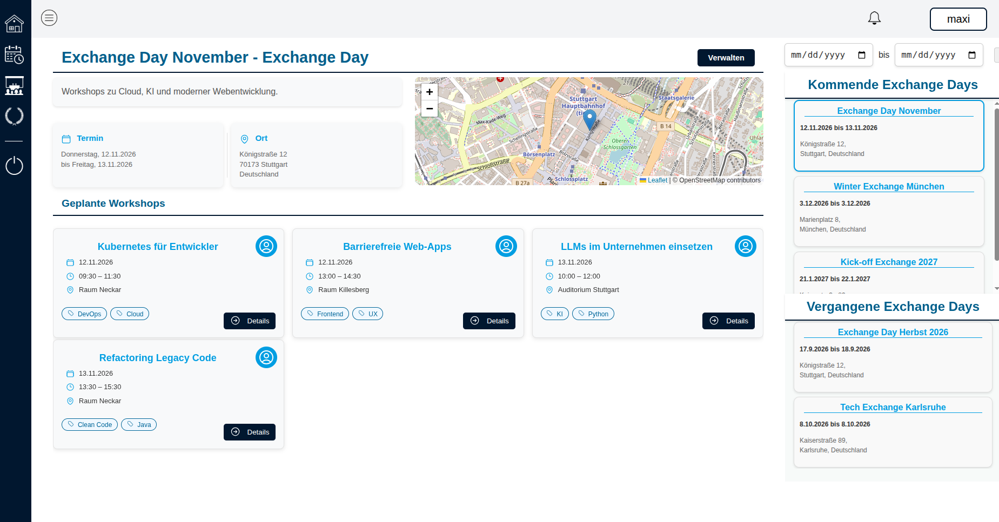

# Exchange Days Management

A web app for Exchange Days: browse workshops and training events, register for them, confirm attendance via QR code and give feedback.

Built with Spring Boot (backend) and Vue 3 + Vite (frontend).



## Features

- View and register for Exchange Days and workshops
- Create Exchange Days and workshops (admins only)
- QR-code based attendance confirmation
- Feedback for attended workshops, with automatically generated summaries for organizers
- Responsive design for desktop and mobile

## How It Works

- **Registration:** After signing up you land on the main page, which lists all Exchange Days and their workshops.
- **Navigation:** The sidebar on the left switches between views.
- **Creating events:** Admins can add new Exchange Days and workshops via the *Create* button. New entries show up on the main page immediately.
- **Attendance:** Each workshop organizer gets a unique QR code for their event. Scanning it confirms the logged-in user's attendance and unlocks the feedback form.
- **Feedback:** Feedback is analyzed automatically. Organizers can view the results under *Meine Events*.

## Getting Started

### Requirements

- JDK 21+
- Maven
- Node.js (on your `PATH`)
- MariaDB on `localhost:3306` with a database named `eaplanner` (credentials in `backend/src/main/resources/application.properties`)

### Setup

```bash
git clone https://github.com/MaximilianRau04/Exchange-Day-Manager.git
cd Exchange-Day-Manager
```

Start the backend (runs on port 8080):

```bash
cd backend
mvn spring-boot:run
```

Start the frontend in a second terminal (Vite proxies API requests to the backend):

```bash
cd frontend
npm install
npm run dev
```

Alternatively, `./start.sh` starts both in detached `screen` sessions (frontend on port 8000) and `./stop.sh` stops them.

### Tests

```bash
cd backend
mvn test
```

## Documentation

- [API documentation](docs/API.md)


